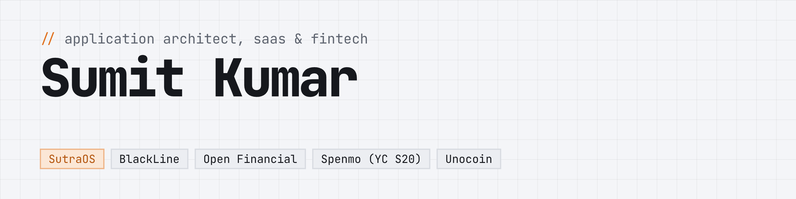

<picture>
  <source media="(prefers-color-scheme: dark)" srcset="./banner-dark.png">
  
</picture>

I design systems that move money and keep an exact record of it. 14+ years in software engineering, 9 of them in architect and lead roles across banking, payments, cards and crypto. Based in Bengaluru.

[](https://sumit22.github.io)
[](https://www.linkedin.com/in/sumit22)
[](https://medium.com/@sumitkumar_71550)
[](https://stackoverflow.com/users/842050/sumit-kumar)

> **Open to** Application / Solution Architect and Lead Engineer roles in fintech or SaaS.

### `// changelog`

```text
2025 – now   SutraOS          Founder & Principal Engineer   multi-tenant SaaS, 17-module DDD monolith, AI video pipeline
2024 – 2025  BlackLine        Senior Software Engineer       financial data pipeline moved onto AWS SQS
2023 – 2024  Open Financial   Lead Software Engineer         20–50x faster production APIs; HDFC Bank platform, team of 5
2020 – 2022  Spenmo (YC S20)  Lead Architect                 multi-currency payins/payouts, card issuing, MatchMove + Rapyd
2017 – 2020  Unocoin          Web Architect                  crypto exchange: legacy PHP → Laravel, multi-country KYC, team of 7
2010 – 2017  HolidayIQ & co.  Engineer                       Solr search, review-fraud detection, growth engineering
```

### `// open source`

| | |
| --- | --- |
| **[sendrail](https://github.com/sumit22/sendrail)**<br><sub>TypeScript · AWS SES</sub> | Email deliverability on your own AWS SES account: sending, delivery feedback, suppression and reputation. The layer you'd otherwise rent from an email provider. Express and NestJS adapters. |
| **[FindMyStar](https://github.com/sumit22/FindMyStar)**<br><sub>Rust · React Native</sub> | Offline AR finder for ~620 stars, planets and Messier objects. Positions computed in Rust against VSOP87/Hipparcos and validated against USNO and JPL Horizons. No network calls. |
| **[time-travel-carousel](https://github.com/sumit22/time-travel-carousel)**<br><sub>TypeScript · React</sub> | A React carousel where every slide has a version history: left/right between items, up/down through revisions. Zero runtime dependencies. |

### `// writing`

**[32 minutes to 2 minutes: rewriting a Symfony integration suite in one PR](https://gist.github.com/sumit22/950bee565eb6a9ea76a6e3212c476b26)**: 684 tests became 881, the run dropped from ~32 min to 2 min 10 s, and three production bugs surfaced along the way.

### `// stack`

<p>
  
  <br>
  
</p>

**Practice:** domain-driven design · event-driven architecture · multi-tenant SaaS · legacy modernisation · PCI DSS (SAQ-A) · GDPR · RBI compliance
